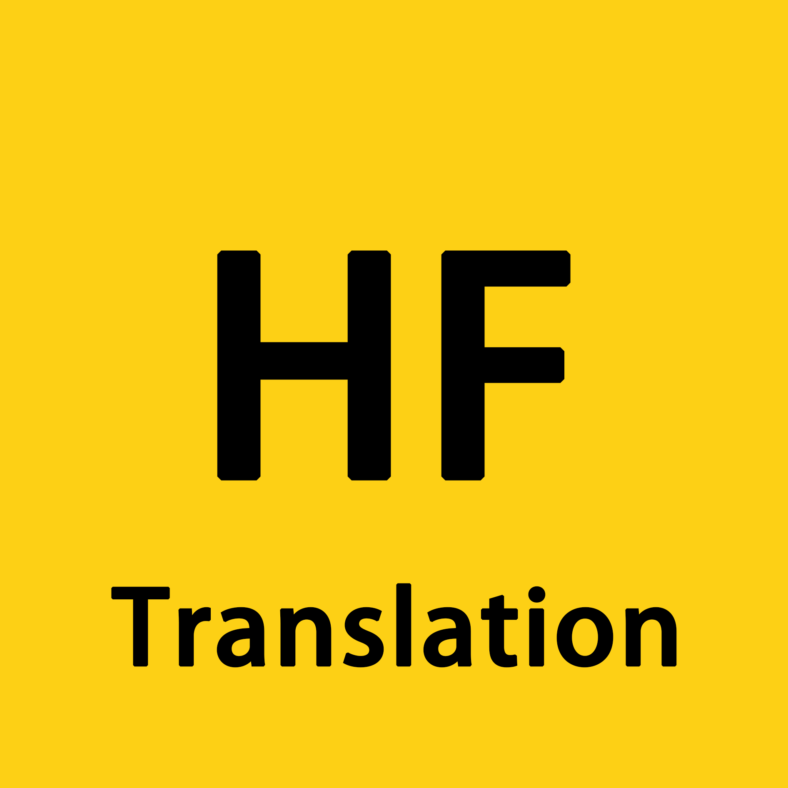

<div align="center">



# HF 中文

**中文化 Hugging Face 与 hf-mirror.com 浏览器插件**

一键将 Hugging Face 界面翻译为简体中文，支持 AI 翻译模型卡 README 与文档长文本。

[](https://developer.chrome.com/docs/extensions/develop/migrate) [](LICENSE) [](https://github.com/JackalEthen/huggingface-Chinese/releases)

</div>

---

## ✨ 功能

### 🌏 界面翻译
- 覆盖导航、筛选器、排序、任务标签、空间状态、组织主页、文档与课程页等 **576 条词条**，持续扩充
- 智能匹配：忽略多余空白与大小写差异
- 即时开关：关闭后**立刻恢复英文**，无需刷新页面

### 🔤 动态文本本地化
- 正则规则层处理词条覆盖不到的组合串：`25.9B rows` → `25.9B 行`、`28B params` → `28B 参数`、`Updated …` → `更新于 …`
- 相对时间本地化：`6 days ago` → `6 天前`、`just now` → `刚刚`、`Jan 9, 2024` → `2024年1月9日`
- 三级兜底：精确词典 → 时间本地化 → 正则规则，逐级命中

### 🤖 AI 翻译长文本
- **模型卡 / 数据集 / Space 页**：按钮显示「翻译 README（AI）」，一键翻译英文 README，保留 Markdown 排版
- **docs / blog 页**：按钮显示「翻译本页（AI）」，直接翻译正文长文档
- 正文不足 800 字符的页面不显示按钮，避免目录页、索引页误触发
- 兼容所有 OpenAI 格式 API：DeepSeek / 智谱 GLM / Qwen / OpenRouter / 自定义
- 翻译结果按页面路径本页缓存，切回原文、往返导航都不重复消耗 token
- API Key 使用本机密钥 **AES-GCM 加密**存储，绝不上传

### 📦 词典自动更新
- jsDelivr 主源 + GitHub raw 兜底双通道拉取
- 日期版本比对，仅更新时覆盖本地词典
- 无需更新插件，词条随仓库自动迭代

### ⭐ 弹窗快捷入口
- **检查更新**：弹窗内一键拉取最新词典，直接显示更新结果
- **GitHub Star**：一键跳转仓库，顺手点个星

## 📦 安装

### 方式一：CRX 安装（推荐）

从 [Releases](https://github.com/JackalEthen/huggingface-Chinese/releases) 下载 `hf-chinese.crx`，双击安装或拖入 `chrome://extensions`。

### 方式二：Zip 源码包（最简单）

从 [Releases](https://github.com/JackalEthen/huggingface-Chinese/releases) 下载 `hf-chinese-v0.3.0.zip`，解压后：

1. 打开 `chrome://extensions`，右上角开启「开发者模式」
2. 点击「加载已解压的扩展程序」，选择解压出的文件夹

### 方式三：源码加载（开发者模式）

1. 下载本仓库代码并解压
2. 打开 `chrome://extensions`，右上角开启「开发者模式」
3. 点击「加载已解压的扩展程序」，选择项目根目录

## ⚙️ 配置 AI 翻译（可选）

长文本翻译（README / 文档页）需要配置一次 API：

1. 点击插件图标 → 「API 与词典设置」
2. 选择服务商预设（自动填入地址和模型）或自定义
3. 填入 API Key →「测试连接」→「保存」

| 服务商 | Base URL | 默认模型 |
|---|---|---|
| DeepSeek | `https://api.deepseek.com/v1` | `deepseek-chat` |
| 智谱 GLM | `https://open.bigmodel.cn/api/paas/v4` | `glm-4-flash` |
| Qwen（DashScope） | `https://dashscope.aliyuncs.com/compatible-mode/v1` | `qwen-plus` |
| OpenRouter | `https://openrouter.ai/api/v1` | `google/gemini-2.0-flash-001` |

> 界面词条翻译**不需要** API，开箱即用。

## 🔐 隐私

- 不采集任何浏览数据，无埋点、无统计上报
- API Key 仅加密存储于本机 `chrome.storage.local`，密钥与密文均不离开设备
- 长文本翻译内容只发送给你自己配置的 API 服务商

## 🛠️ 构建

```powershell
# 一次性打包：生成图标 → 产出 CRX → 产出 Zip 源码包
powershell -File scripts\pack.ps1
```

产物在 `release/`：

| 文件 | 用途 |
|---|---|
| `hf-chinese.crx` | Chrome / Edge 直接安装 |
| `hf-chinese-v0.3.0.zip` | 解压后开发者模式加载 |
| `hf-chinese.pem` | 签名私钥，**不入库、勿丢失** |

**首次打包会生成 `release/hf-chinese.pem` 私钥，后续版本必须用同一把，否则已安装用户无法覆盖升级。**

## 📁 目录结构

```
├── manifest.json      # MV3 配置
├── content.js         # 页面翻译 + 规则层 + 长文本翻译按钮
├── background.js      # 词典更新 + LLM 翻译桥 + Markdown 转 HTML
├── dict.json          # 词条（_v 日期版本字段）
├── popup.html/js      # 弹窗：开关 + 词典状态 + 检查更新 + Star
├── options.html/js    # 设置页：API 配置 + 加密
├── icons/             # 16/32/48/128
└── scripts/           # 图标生成 + CRX/Zip 打包
```

## 🤝 贡献词条

发现未翻译的界面文字？欢迎直接编辑 [dict.json](dict.json) 提 PR：

```json
"English Text": "中文翻译"
```

合并后已安装用户将自动收到词典更新（最长 12 小时 CDN 缓存）。

## 📄 License

[MIT](LICENSE)
